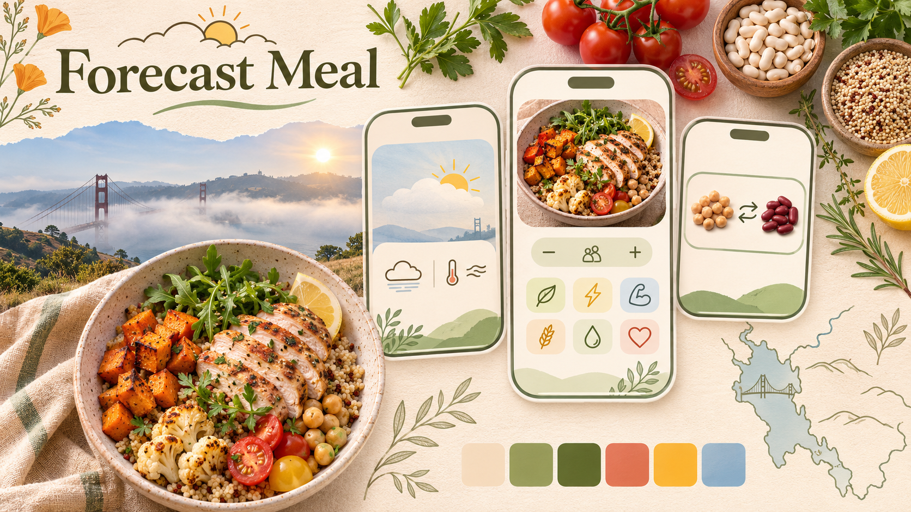

# Forecast Meal


## Project Goal

I am building a lightweight app to help busy college students choose a healthy meal based on their local weather forecast.


## Target Audience

My target audience is college students who prefer cooking at home and want simple, healthy recipes.
 

## Mood Board


Note: AI-generated image


## Overview

Forecast Meal is a lightweight, mobile-first class experiment by Ken Pao for MM-621, Interaction Design Studio II. The proposed app uses today's local weather forecast to suggest one healthy meal, with ingredient quantities, simple cooking steps, adjustable servings, and a per-serving nutrition table with p5.js category icons. It is intended to be free for classmates to try.

The [Project 3 proposal](PROPOSAL.md), dated November 11, 2026, is the source of truth for the project direction, scope, and delivery plan. Read the [published proposal](https://kpao2020.github.io/MM-621/projects/p3/PROPOSAL.html) on GitHub Pages; the local proposal may contain updates that have not yet been published.


## Current status

The local app now includes both the NWS forecast/location flow and the first forecast-to-recipe flow. It offers six Bay Area cities or an explicit one-time device location. Once a forecast loads, choose no preference, balanced, meat eater, vegetarian, vegan, or pescatarian; select a preferred cuisine and exclusions from fixed lists; choose one to four servings; and request a single recipe after Turnstile verification. Ingredient amounts scale when servings change. The page contains no free-text meal prompt.

The Worker validates the request fields and forecast freshness, sends only normalized forecast categories and the selected controls to Workers AI, checks the structured recipe against the controls, and returns it without saving the request or recipe. It applies the existing per-IP burst limit and does not use a database or shared daily recipe counter. The local code uses a Workers AI model documented for JSON Mode. The updated Worker has been deployed; the updated frontend has not yet been published. End-to-end recipe generation still needs a successful browser check.

Ingredient substitutions and the estimated nutrition table with p5.js icons remain the next project steps. The nutrition estimates are not part of this recipe response.

The repository still contains Basket Buddy's Open Prices catalog, D1 search, meal-request flow, and refresh tooling. Those files document the earlier experiment and do not define Forecast Meal's scope. Where older implementation documents differ from the proposal, follow the proposal.


## Planned experience

1. Choose Hayward, Oakland, San Francisco, San Jose, San Mateo, or Dublin, California, or explicitly select “Use my location.” Only the device-location choice triggers a browser permission request. City selection remains available if permission is denied or the forecast fails.
2. View today's local National Weather Service forecast.
3. Choose a dietary pattern: no preference, balanced, meat eater, vegetarian, vegan, or pescatarian. Select a preferred cuisine, ingredients to exclude, and one to four servings. There is no open-ended meal prompt.
4. Complete Turnstile verification and request one recipe. With no dietary selection or exclusions, the default is a generally balanced meal containing vegetables, a protein, and a grain or starch.
5. View ingredient quantities and simple preparation steps. Request one AI-suggested ingredient substitute at a time; applying it updates the relevant quantities, instructions, and nutrition estimates.
6. View estimated calories, protein, carbohydrates, total fat, fiber, and sodium per serving, with a reusable p5.js icon for each category.

Nutrition values are AI-generated estimates informed by USDA FoodData Central reference data and may be inaccurate; use for reference only. The prototype does not calculate nutrients ingredient by ingredient from the USDA API. Its “healthy” default is a class-project guideline, not an assessment of a person's medical or nutritional needs. Dietary labels and exclusions do not verify allergies or provide medical nutrition advice.


## Scope

The project tests one contextual meal suggestion, dietary and ingredient-exclusion controls, one-at-a-time substitutions, serving adjustments, and a visual nutrition summary. The result visual is a nutrition table with category icons.

Nutrition tracking, weekly meal planning, grocery prices, store inventory, ordering, accounts, and saved meal history are outside the proposed scope.


## Why the direction changed

Basket Buddy explored whether community-reported Open Prices records could support a useful local grocery basket. The research documented in the proposal found:

- The 50-mile Hayward snapshot contained 42,342 observations, but only 3,904 (9.2%) were from the previous 30 days. The median observation was 288 days old.
- Expanding the radius to 300 miles added only three recent observations.
- Ingredient and package matching could produce impractical shopping suggestions, such as buying a full bottle of soy sauce for one recipe. Recorded prices did not confirm current availability.

Instructor feedback also raised questions about shopping convenience, cuisine and dietary preferences, and substitutions. Forecast Meal shifts the interaction toward cooking one meal using the local forecast and selected preferences.

The proposal compares Eat AI and Mealime and acknowledges that weather-based meal suggestions already exist. Forecast Meal's contribution is a small class experiment connecting the earlier weather-data project to one meal and a visual nutrition summary.

See the [50-mile analysis](open-prices-hayward-50mi-analysis.md), [radius comparison](open-prices-radius-expansion-analysis-2026-11-10.md), and the proposal's Research section for details.


## Planned technology

- p5.js 2.3.3, HTML, CSS, and JavaScript for the mobile interface, recipe controls, nutrition table, and category icons. The local p5.js copy is at `../../lib/p5.min.js`.
- National Weather Service API for today's forecast at supported U.S. coordinates.
- Browser Geolocation API for optional, user-authorized location, with manual city selection as an alternative.
- Cloudflare Workers and Workers AI for the meal-only service, structured generation, and server-side validation.
- Cloudflare Turnstile for bot checks, with server-side token validation.
- GitHub Pages for the public class prototype.
- USDA FoodData Central as the reference source for AI-estimated nutrient values.

The Worker accepts only the fixed dietary pattern, preferred cuisine, allowlisted exclusions, serving count, normalized forecast, and Turnstile token. It verifies the token server-side for the expected hostname and action, makes one bounded structured-generation request, and rejects malformed or preference-conflicting output. A valid token collapses the widget and leaves a visible “Verified” status; expired or failed verification restores the check. This is a prototype validation layer, not a guarantee that model output is medically or allergen safe.


## Privacy and service limits

Device location is optional and requires an explicit user action and browser permission. The proposed implementation uses a one-time reading only to retrieve the local forecast. The weather service receives the location needed for that request; the meal-generation service receives the forecast summary and supported meal controls, without device coordinates or unrestricted user text.

Coordinates must stay out of AI prompts, meal history, and application logs. The proposed app does not persist location or save meal history. Provider handling and Worker logs must be checked before publishing the location notice.

The Worker retains a per-IP burst limit; it does not impose a shared daily recipe limit. Workers AI can still reject a request if the account allocation or billing configuration is unavailable; verify Cloudflare account limits before presenting generation as free. The Turnstile secret stays in the Worker secret store; the site key and Worker URL are public browser configuration.


## Proposed three-week plan

| Week | Focus |
|---|---|
| 1 | Retrieve today's forecast for the six cities; add optional device location, city fallback, and visible location and forecast information. |
| 2 | Add dietary, ingredient-exclusion, and serving controls; generate and validate one recipe; implement substitutions that update quantities and affected instructions. |
| 3 | Display per-serving nutrition estimates and p5.js category icons; complete verification states, the location notice, error handling, review, and class demonstration. |

The proposal's Success Criteria section defines the complete acceptance criteria.


## Run the forecast prototype locally

The weather section works independently. Recipe generation requires the Worker, a Turnstile widget/secret pair for the current hostname.

1. Serve the repository root with VS Code Live Server or `python3 -m http.server 5500`.
2. Open `http://localhost:5500/projects/p3/`. The app loads Hayward's forecast automatically. Choose another city or explicitly tap “Use my location.”
3. Device location needs HTTPS or localhost and browser permission. Browser and operating-system location settings both affect availability. A phone opening a plain HTTP LAN address may use the city selector, but device location requires HTTPS.

The local page uses the deployed Worker URL in `config.js`. The deployed Worker accepts browser requests from `https://kpao2020.github.io` only and verifies that hostname in Turnstile. Review the local page and weather flow locally; test recipe generation after publishing the updated frontend to GitHub Pages. A verified badge alone does not establish that the Worker accepted the token or generated a recipe.

The app reads location once per explicit device-button click. Refresh uses the already resolved NWS grid without reading device location again. Forecasts refresh after 20 minutes, when the first displayed period ends, or after local midnight while the page is visible. Returning to a backgrounded page also checks whether a refresh is due. NWS outages, missing data, unsupported locations, permission denial, and timeouts leave city selection available. A future forecast is never silently substituted for today's missing data.

The location notice describes this app's behavior; NWS receives the request and applies its own provider policies. This app does not persist coordinates or log them, and requests use no-store, omit credentials, and suppress the referring page. The browser, operating system, network, and NWS still handle the location request.

Before recipe generation can work on GitHub Pages, publish the updated frontend and confirm its Turnstile configuration. The next feature phase is one-at-a-time ingredient substitutions followed by per-serving nutrition estimates and p5.js nutrient icons.

For production activation, from `projects/p3/worker`, deploy the Worker:

```sh
npx wrangler deploy
```

Check the Worker URL, `forecast_recipe` Turnstile action, allowed production origin, hostname, and secret before publishing the updated frontend. The latest Worker is deployed; the updated frontend still needs publishing and an end-to-end check. The earlier catalog's operating instructions remain in [DATA-PIPELINE.md](DATA-PIPELINE.md); the Forecast Meal recipe route does not use the price catalog.


## Project files

- [PROPOSAL.md](PROPOSAL.md): source of truth for Forecast Meal's rationale, research, scope, flow, privacy requirements, and plan.
- `index.html`, `style.css`, `sketch.js`, `weather-api.js`, `recipe-api.js`, and `config.js`: active forecast/recipe interface, p5.js illustration, NWS client, supported meal controls, and public service configuration.
- `api.js` and `results.js`: retained legacy Basket Buddy client code; not loaded by the Forecast Meal page.
- `worker/src/index.js`: recipe-only Worker route, Turnstile verification, structured response validation, and request limits.
- Other files under `worker/` and `tools/refresh_open_prices.py` are retained from the earlier Basket Buddy experiment. Its scheduled GitHub workflow was removed.
- [DATA-PIPELINE.md](DATA-PIPELINE.md): earlier Open Prices setup and operations.
- [requirements.md](requirements.md): current forecast requirements and remaining meal-service work.
- [tracking.md](tracking.md) and [memory.md](memory.md): work status and confirmed decisions, including historical implementation notes.
- [agents.md](agents.md): project collaboration instructions; legacy product rules are superseded by the current proposal and confirmed user decisions.


## Credits and references

The [proposal's reference list](PROPOSAL.md#resources-references) contains the technology documentation and competitive research.

Product and price observations for the original Basket Buddy prototype came from [Open Prices (Open Food Facts)](https://prices.openfoodfacts.org/) under the [Open Database License (ODbL) v1.0](https://opendatacommons.org/licenses/odbl/1-0/). Its original basket illustration was created in p5.js without an external image. The current weather-and-bowl illustration is original p5.js work with AI-assisted revisions. Forecast Meal's nutrition table and category icons remain planned p5.js and HTML/CSS work.
